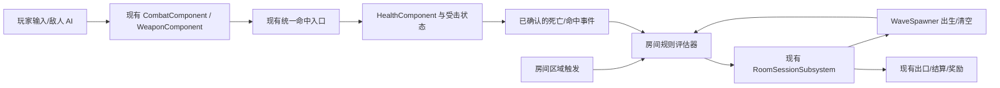

# 服务端战斗与场景架构适配设计

状态：设计方案，尚未实施。2026-10-23。正式执行状态只看 `TASKS.md`；本文不代表 UE 项目已有下述新规则能力。

## 1. 目标与边界

参考 `C:/Users/mei/Desktop/game/` 中的 Lua 游戏服，改进当前 UE 5.8.3 **单机** 3D 横版刷图原型的战斗与场景组织方式。玩家仍以 X 横向、Y 地面纵深、Z 高度移动；固定侧视镜头、现有近战连招、枪械、两波房间和存档保持可用。本文只提取设计方法，不复制 Lua 实现、数值表或其运行时依赖。

本轮仅形成可实施设计。联网账号、多人同步、跨服、服务端权威裁决、AOI 网络广播、服务端路径搜索、付费或新素材均不进入本阶段。服务端源目录只读，不纳入 UE 仓库，也不作为新的线上服务部署。

## 2. 源码观察

以下是服务端代码的实际职责，不等同于 UE 当前实现。

| 主题 | 服务端实现依据 | 提炼出的模式 |
|---|---|---|
| 战斗实体 | `service/world/battle/actor/Fighter.lua:74-120` 组合移动、属性、技能、受击、Buff 等模块，`BattleScene.lua:78-127` 维护实体集合和场景控制器 | 实体只组合能力；生命、技能、场景流程各有所有者 |
| 技能准入 | `handler/SkillHandler.lua:13-72` 检查请求和技能配置；`actorModule/skill/SkillModule.lua:461-607` 检查已学、形态、状态、打断、CD/充能后创建技能实例 | 输入是意图；准入先于动作提交，拒绝有明确原因 |
| 分段执行 | `actorModule/skill/ActiveSkill.lua:193-365` 为阶段设置持续时间、免疫标记、伤害/下一段定时器，定时回调用技能 serial 与 stageId 验证 | 阶段时间表与动作实例身份分离；旧回调不能作用于新动作 |
| 命中与效果 | `actorModule/skill/SkillDamage.lua:88-342` 按目标类型、区域形状、数量和距离筛选；`:343-504` 处理命中、伤害、吸血/反伤；`SkillStrikeModule.lua:149-189` 处理受击控制 | 查询、伤害、控制和表现有先后顺序，目标筛选不等于确认命中 |
| 场景实例 | `scene/BattleScene.lua:78-219` 持有场景实例、地图格、实体、玩法及控制器；`:287-431` 区分静态/动态阻挡、安全区与传送点；`:683-749` 更新实体与场景逻辑 | 场景身份、空间边界、动态状态与逐帧更新独立管理 |
| 场景阶段 | `scene/BattleControl.lua:58-170` 创建刷怪、规则、区域控制器；`:249-404` 和 `:554-610` 管理准备、倒计时、运行、结算与关闭 | 一次场景运行有唯一阶段所有者；结束先停 AI，再结算 |
| 规则与事件 | `scene/BattleLoader.lua:27-75` 从关卡配置加载刷新组和规则；`scene/rule/SceneRuleControl.lua:185-230` 接收刷怪死亡、进出区域等事件；`SceneRuleEffect.lua:16-70` 执行刷新、通关、失败等效果 | 配置描述有限条件与效果，事件驱动关卡推进 |
| 转场 | `agent/scene/SceneTransfer.lua:84-181` 进入前标记转场状态，异步创建场景后再次校验状态，不合法时清理新实例 | 旧场景回调与迟到的转场结果不能污染新场景 |

注意：服务端 `SkillHandler` 的参数检查并不证明所有客户端坐标都经过权威重算；`SceneRuleControl` 对未知效果的分支也没有统一报错。UE 方案要独立校验，不照搬这些边界。服务端的平面 `x/z` 地图坐标不可直接套到 UE 的 X/Y/Z；UE 的 Y 纵深和 Z 高度必须分别保留。

## 3. UE 当前基线与差距

| 已有能力 | 当前文件 | 仍需改造的点 |
|---|---|---|
| 60Hz 动作时钟、输入缓存、攻击实例、窗口、取消与受击状态 | `Combat/CombatComponent.cpp:243-289`，`Combat/AttackDefinition.h` | 保留为近战动作唯一状态源；未来多阶段技能用同一实例/时钟，不并列第二个技能计时器 |
| 统一命中入口、伤害计算、反应和去重 | `Combat/System/UnifiedHitApplier.h`、`DamageResolver.*`、`HitLedger.*` | 场景规则只消费已确认的命中/死亡事件，不直接扣血；规则不能绕过拒绝原因和 Ledger |
| 房间身份、失败/清关、刷怪与重试 | `Room/RoomSessionSubsystem.cpp:176-381`、`:478-669`，`WaveSpawner.*` | 当前波次固定按“全员出生且死亡→1 秒→下一波”，还没有可配置的区域/波次事件规则 |
| 房间进入触发器与房间定义 | `Room/RoomTrigger.cpp:144-215`，`Room/RoomDefinition.h`，`Data/rooms.json` | 触发器只在首次重叠后立即开波；运行时还有默认两波替身，房间源数据与实际资产要在改造时统一 |
| 战斗房间出口 | `Room/RoomTrigger.h` 下方的 `ARoomExit` 及房间状态事件 | 保留出口对清关结果的现有响应，不另建一套通关/奖励状态 |

两个已读代码中的具体风险需列入实施前置：`RoomSessionSubsystem.cpp:381-417` 对运行中未知或重复 `EnemyId` 仍增加 `KilledCount`，虽然存活集合防止了跳波，结算计数可能失真；`RoomTrigger.cpp:201-208` 资源加载失败时保留 Running 且不开波，玩家可能落入无法完成的房间。它们是待修复建议，本文没有修改游戏代码。

## 4. 方案比较与决定

| 路线 | 收益 | 代价与风险 |
|---|---|---|
| A. 逐层移植 Lua 战斗/场景框架 | 与源服务端概念最像 | 会并列现有 CombatComponent、HealthComponent 和 RoomSession；大量 MMO 网络/配置假设不适用 |
| **B. 在现有 UE 所有者上增加有限场景规则（推荐）** | 保留已验证的命中、状态与存档；一次只替换硬编码波次推进 | 需增加房间规则数据、运行时校验和地图区域事件 |
| C. 只调两波和敌人数值 | 变动小 | 无法复用服务端“事件→条件→效果”的方法，也解决不了旧回调与卡关风险 |

采用 B。战斗侧先巩固现有统一入口与场景事件边界；不为了形式相似重写伤害公式、连招或武器。场景侧先给现有两波房间提供可配置规则，并保持默认玩法一致，后续才加入需要用户决定的关卡变化。

## 5. 目标结构

### 5.1 所有权

- `CombatComponent` 继续拥有攻击实例、60Hz 时间和中断；`WeaponComponent` 拥有开火事务；`HealthComponent` 是 HP 与死亡唯一来源；统一命中入口决定一次命中是否被接受。规则层不维护第二份攻击、HP 或受击状态。
- `URoomSessionSubsystem` 继续拥有 `RunId`、状态、波次、敌人集合和唯一结算结果。新增规则评估器只拥有**当前 RunId 内的规则进度**，输出有限的“请求开波/清关/失败”，由 Session 最终准入。
- `URoomDefinition` 的规则配置来自 `Data/rooms.json` 的权威源，经结构化解析、校验和 UE 资产生成/重载；运行时只用 Cook 后资产。现有 transient fallback 作为迁移过渡，不能长期与源表各自维护一份规则。
- `AActor` 引用保持弱引用且仅限 World 生命周期；跨地图的 Profile 只保留业务存档。离房、失败、重试、World EndPlay 清空规则进度、区域订阅与延时事件。

当前 `Data/rooms.json` 为 `schema_version: 1`，且其 `room_training_01` 与触发器默认的 `room_combat_01` 是两条名称不同的入口。实施时先明确生产房间唯一 ID 与生成资产路径；新增规则字段使用 schema 2，旧 schema 1 显式迁移为现有“进入开第 0 波、清空后间隔 1 秒、最后清关”的规则，不依赖静默默认值。存档中的结算身份不因配置版本变化而重新生成。

### 5.2 最小规则模型

首版只允许以下有类型的事件：`PlayerEnteredRegion(region_id)`、`WaveCleared(wave_index)`、`PlayerDied`。`WaveCleared` 仅在该波 `PendingSpawns==0` 且 alive 集合为空时发出；单个 `EnemyDied` 不能直接视为清波。

规则字段建议为 `rule_id`、`event`、可选 `region_id/wave_index`、`effect`、可选 `next_wave_index/delay_s`、`once`。效果白名单仅 `StartWave`、`MarkCleared`、`FailRun`；出口继续监听 Session 的清关结果，不单独维护开门标记。首版只支持单事件匹配与同规则 `once`，复杂 AND 条件、概率、剧情、动态障碍留到具体玩法提出后另立项。无效事件/效果名、重复 ID、越界波次、规则图中无终态路径、负延时和规则环必须在生成资产前拒绝，不运行时静默忽略。区域在地图上是否真的可抵达，则由地图验收检查。

现有两波默认语义可表达为：进入战斗区域→第 0 波；第 0 波清空→用注入的房间时钟延时 1 秒启动第 1 波；第 1 波清空→清关；玩家死亡→失败。规则评估器不发奖，`MarkCleared` 后仍由既有 SettlementId/奖励链处理。

### 5.3 事件契约与顺序

事件值至少包含 `RunId`、`RoomId`、事件类型、波次/区域 ID、会话时钟时间，以及当前运行内单调 `EventSequence`。事件由 World 本地生成，不接受输入中声称的最终伤害或死亡结果。只对当前 Running 且 RunId 匹配的事件求值；同 `EventSequence` 重放、已经达成的 once 规则、迟到的 Spawn/Kill/Overlap 都不再触发效果。

处理顺序：来源先完成自身准入与状态提交→发布事件→规则校验并临时保留一次性规则→请求 Session 执行效果→成功后确认规则完成并由 Session 广播状态。同步重入或重复事件看到保留态时不能再执行；效果被拒绝时记录具体原因，不能留下已完成但无效果的规则，必要时由 Session 失败结束本局。延时使用 `SetSessionClockSeconds` 注入的时间，运行内必须单调；暂停时不推进，离房/重试时按 RunId 取消，时间到了也再次验证当前 run。规则不能在 `OnRunEnded` 回调中再次发起结算。

首版场景规则只消费已确认的死亡所产生的 `WaveCleared`，不消费单次命中；未来若需要命中触发规则，事件只能来自 `UnifiedHitApplier` 的接受结果。死亡由 `HealthComponent` 的单次死亡广播转入现有波次记账。范围查询继续使用 UE 世界空间与现有目标策略，Facing ±1 只镜像 X。场景区域是 3D Box/Volume，X 与 Y 都参与判定，Z 只用于高度边界；不得锁住 Y。训练场未置房间规则时保持现在的自由练习。

### 5.4 技能设计取法

现有攻击定义已有 active/cancel 窗口，已经覆盖服务端“阶段时间表”的首个用途。后续新增技能时，先定义按 ID 可查的受限配置：阶段持续帧、启动/生效/恢复窗、目标过滤、命中组、CD/资源成本、允许取消目标。提交顺序为：输入意图→技能/装备/生存/场景条件→CD 与成本预检→分配攻击实例→阶段推进→范围查询→统一命中→确认事件。拒绝必须带明确原因，预检失败不扣资源；中断后旧阶段定时器因实例 ID 不匹配而失效。

此阶段**不改变**当前四招和八武器的数值、键位与取消窗口。充能、概率命中、吸血、反伤、复杂 Buff、客户端预测/服务器回滚先不加入；它们在源服务端存在，但单机玩法未提出对应需求。

## 6. 分阶段实施顺序（均为建议，尚未领取）

1. **基线与数据闭环**：补房间配置的单一源到资产加载路径，修正未知/重复击杀计数和资源缺失后卡 Running 的失败路径。先复测现有 2+3 波、失败、重试和奖励不重复；保留旧存档。此项不得改变可见玩法。
2. **有限场景规则**：新增规则数据校验、RunId 内评估器、区域事件与波次完成事件；用规则重现现有两波 1 秒间隔。一次只由 Session 开波/结算，重复/旧事件无效。地图资产通过 UE 编辑器 API 修改并重启重载验证。
3. **战斗事件接线**：确认近战、枪械、投射物经现有统一命中、生命死亡与波次记账到达 `WaveCleared`；保持共用命中去重，不允许规则按 Overlap 自行扣血。实际需要命中触发或新技能时另拆事件、动作配置与资源事务任务。
4. **整体验收**：完整 Build；定向自动化涵盖无效规则、旧 RunId、重复死亡、延时取消、Y 纵深区域、失败与重试；`Test.ps1` 与 `Test.ps1 -Render` 并查看新截图；固定目录打包后跑包内房间/武器场景。每次验收同时检查 exit、当次 JSON `success=true` 和 UE 日志。真实键鼠手感与声音仍待用户试玩反馈，不由 AI 代签。

后续实施按 `Docs/Tasks/执行与交接规则.md` 拆成独立任务卡（超过 90 分钟或涉及两种可独立拒绝的行为继续拆分），依赖全 DONE 才领取。M5-H02 目前仍是人工 REVIEW；本设计不会将其改为 DONE，也不会提前启动依赖它的车辆等任务。

## 7. 验收判据与风险

- **兼容**：现有训练场、两波房、近战连招、枪械和八武器表现维持；默认房间仍为第 0 波清空后 1 秒启第 1 波。X/Y 移动、跳跃和镜头不退化。
- **身份与幂等**：同 RunId 的第 0 波仅启动一次；未知、重复或旧 run 的死亡与区域事件不增加击杀、不跳波、不二次发奖；失败和清关由先到的终态决定。
- **失败可见**：配置缺失、敌人资产缺失、生成失败有明确错误并进入可重试状态；不会留一个没有敌人且不能通关的 Running 房间。
- **可维护**：规则错误在构建/资产生成阶段定位到 room/rule/field；无任意脚本表达式。Session 只有一个状态与结算所有者，规则评估器可单测，地图区域可在编辑器可视化。
- **资料限制**：服务端目录没有看到可直接用于 UE 的资产授权或 5.8.3 集成契约；本方案只借鉴架构，不导入其资源。是否需要改变场景节奏、加入安全区或多阶段技能，留给用户试玩后作玩法决定。
